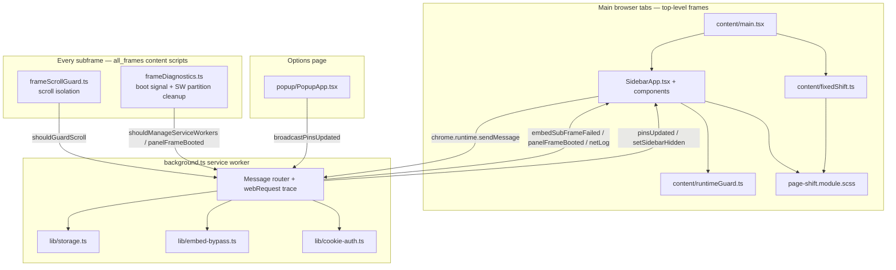

# browser-sidebar — Implementation Guide

This document describes how the extension works so a new agent session can understand the repo without re-discovering behavior from scratch.

## Purpose

browser-sidebar is a **Chrome Manifest V3 extension** that brings a native-style sidebar to normal web pages. It is **not** native browser chrome — it injects UI into page viewports and shifts page content with CSS margins.

**Primary UX:**

1. A fixed **48px icon strip** on the left of every `http(s)` page (hideable via toolbar icon).
2. An expandable **in-page panel** (300–1000px) that **overlays the page** (Opera-GX popover style) and loads pinned sites in an `<iframe>`. The panel is tried **first for every pin** — the background service worker strips iframe-blocking response headers (`X-Frame-Options`, CSP `frame-ancestors`) for pinned domains via `declarativeNetRequest`. See **Embed bypass** below for the full layered strategy.
3. If a site still can't render in the panel (rare — app-level JS/OAuth anti-framing checks that don't rely on headers), the runtime iframe-verification layer detects the failure and the panel shows an **in-panel fallback view** (pin icon, pin name, "This site could not load in the panel.") with an **Open in new tab** button and a **Repair & retry** button.
4. **Inline settings** (gear icon) to add/edit/remove/reorder pins, adjust panel width, and reset to defaults.
5. **Instant pin switching** — up to 4 recently used panel iframes stay mounted (hidden) behind the panel ("warm frames"), and hovering a pin for 150ms speculatively preloads its frame, so clicking it is warm-instant.

---

## Architecture



**Stack:** TypeScript, React 19, SCSS modules, Vite + `@crxjs/vite-plugin`. Content script mounts a React tree inside a closed Shadow DOM.

### Why not a native sidebar?

Native browser sidebars render sidebar apps in **real top-level browsing contexts**, which are never subject to `X-Frame-Options` / CSP `frame-ancestors` — those headers only govern embedding inside an `<iframe>`. Chrome extensions can only:
- Inject into pages (`content_scripts`)
- Open tabs/windows (`chrome.tabs`, `chrome.windows`)
- Rewrite network response headers for requests they have host permission for (`declarativeNetRequest`)

There's no extension API to create a real top-level browsing context docked beside the page the way native browser sidebars do, so this extension uses an `<iframe>` inside the injected sidebar. Sites like X, Instagram, and Discord send `X-Frame-Options` / CSP `frame-ancestors` headers specifically to block that kind of iframe embedding.

**The fix (`lib/embed-bypass.ts`):** since the extension already has `<all_urls>` host permission, it uses `declarativeNetRequest` to strip those response headers for `sub_frame` requests to pinned domains before they reach the renderer. The remaining gap: a handful of sites (mainly OAuth/sign-in flows) also refuse framing via JavaScript or server-side checks unrelated to response headers — those show the in-panel fallback view with an "Open in new tab" button.

---

## File map

| Path | Role |
|------|------|
| `manifest.json` | MV3 config; 3 content-script entries (see below); `@crxjs/vite-plugin` builds to `dist/` |
| `src/background.ts` | Service worker: messaging hub, embed-bypass rule sync + fast path, cookie relax + watcher, `webRequest` debug trace, partition repair, sub-frame message relays |
| `src/content/main.tsx` | Entry (top frames only): bootstrap, shadow DOM mount, React root |
| `src/content/SidebarApp.tsx` | Main UI state: pins, panel, warm frames, iframe verification, settings |
| `src/content/runtimeGuard.ts` | Extension-context invalidation guards (`browserSidebarRuntimeAlive`, `browserSidebarSafeSendMessage`) |
| `src/content/fixedShift.ts` | Shifts `position: fixed` page elements right of the sidebar (translate override + MutationObserver) |
| `src/content/frameScrollGuard.ts` | Content script in **every subframe** (`all_frames`): asks the background whether this frame is a pinned-site embed; if so applies `overscroll-behavior: contain` |
| `src/content/frameDiagnostics.ts` | Content script in **every subframe** (`all_frames`, `document_start`): boot signal (`panelFrameBooted`), in-frame diagnostics, and partitioned-service-worker cleanup for pinned origins |
| `src/content/components/IconStrip.tsx` | Pin buttons + gear; hover/press preload hooks |
| `src/content/components/AppPanel.tsx` | Iframe panel (one iframe per warm frame), loading/fallback views, resize handle, Repair & retry |
| `src/content/components/SettingsPanel.tsx` | Inline settings UI |
| `src/content/sidebarUtils.ts` | Page-shift injection, layout classes, CSS variables, storage load |
| `src/content/keyboardIsolation.ts` | Prevents host-page shortcuts from swallowing sidebar input |
| `src/content/sidebar.module.scss` | Shadow DOM styles (dark theme) |
| `src/content/page-shift.module.scss` | Shifts `html` margin when the strip is visible; drives `--browser-sidebar-shift` for fixed elements |
| `src/lib/defaults.ts` | Constants, default pins, `browserSidebarClamp` |
| `src/lib/storage.ts` | `chrome.storage.sync` read/write helpers |
| `src/lib/embed-bypass.ts` | Syncs two `declarativeNetRequest` session rules: response-header stripping + `CORP: cross-origin` (rule 1) and `Sec-Fetch-*` spoofing (rule 2), for `sub_frame` requests to pinned domains |
| `src/lib/cookie-auth.ts` | Re-writes pinned-site cookies to `sameSite: 'no_restriction'` + `cookies.onChanged` watcher so panel iframes reuse existing sessions |
| `src/lib/pin-utils.ts` | Icon URL resolution, URL parsing, pin reindexing, `getCurrentPagePinDefaults()` |
| `src/lib/types.ts` | Shared TypeScript interfaces |
| `src/popup/*` | Full-page options UI (`options_ui`); mirrors inline settings |
| `icons/apps/*` | Default pin SVG icons |
| `tests/e2e/scrolltest.js` | Playwright-based e2e scroll test |

**Content-script entries (manifest):**

| Script | Frames | Run at | Purpose |
|--------|--------|--------|---------|
| `main.tsx` | top-level only | `document_start` | Sidebar UI |
| `frameScrollGuard.ts` | all frames | `document_idle` | Scroll isolation for pinned embeds |
| `frameDiagnostics.ts` | all frames | `document_start` | Boot signal + SW partition cleanup |

**Build:** `npm run build` → `dist/`. Load unpacked from `dist/`.

---

## Permissions

```json
["storage", "scripting", "tabs", "windows", "cookies", "declarativeNetRequestWithHostAccess", "webRequest", "browsingData"]
```

- `storage` — pins/settings/`lastActivePinId`/`sidebarHidden` in `chrome.storage.sync`
- `scripting` — fallback inject when toolbar click hits a tab without content script
- `tabs` — `openTab` message (open a pin's URL in a new tab); sidebar hide broadcast
- `windows` — window management for tab opening
- `cookies` — re-writes pinned-site cookies with `sameSite: 'no_restriction'` so panel iframes reuse existing sessions (`lib/cookie-auth.ts`)
- `declarativeNetRequestWithHostAccess` — lets the background worker strip `X-Frame-Options` / CSP response headers and rewrite `Sec-Fetch-*` request headers for pinned domains (`lib/embed-bypass.ts`); requires the existing `<all_urls>` host permission
- `webRequest` — **debug-only** network trace for panel embeds: logs every `sub_frame` request/response/redirect/failure in the service-worker console (mirrored to the tab console via `netLog`) and forwards real network failures (`ERR_BLOCKED_BY_RESPONSE`, …) to the content script as `embedSubFrameFailed`
- `browsingData` — partition repair (`repairEmbedPartition`): the full `browsingData.remove` is the only verified way to evict third-party storage-partitioned service workers serving cached `X-Frame-Options` responses
- `host_permissions: ["<all_urls>"]` — content scripts on all normal pages; also backs the header-stripping rule above

---

## Data model

### Pin (stored in `chrome.storage.sync`)

```ts
{
  id: string,        // e.g. "discord" or "custom-1734567890"
  name: string,
  url: string,       // full https URL
  iconUrl: string,   // extension-relative ("icons/apps/x.svg") or absolute http(s)
  order: number      // strip sort order
}
```

### Settings

```ts
{
  panelWidth: 600,
  theme: 'dark'
}
```

### Storage keys

| Key | Location | Purpose |
|-----|----------|---------|
| `pins` | sync | Ordered list of pins |
| `settings` | sync | Panel width, theme |
| `lastActivePinId` | sync | Last clicked pin |
| `sidebarHidden` | sync | Whether icon strip is hidden on all pages |

`chrome.storage.session` is **not** used for panel state anymore — the extension performs a one-time cleanup of the stale pre-rename keys (`gxPanelOpen` / `gxPanelPinId`) at worker startup. Panel open state is per-tab React state.

### Defaults

Defined in `src/lib/defaults.ts`:
- `BROWSER_SIDEBAR_DEFAULTS.DEFAULT_PINS` — 7 default apps (Messenger, Instagram, X, YouTube, YouTube Music, ChatGPT, Claude)
- `BROWSER_SIDEBAR_DEFAULTS.PANEL_MIN_WIDTH` / `PANEL_MAX_WIDTH` / `PANEL_WIDTH` — 300 / 1000 / 600px panel sizing limits
- `BROWSER_SIDEBAR_DEFAULTS.STRIP_WIDTH` — 48px
- `BROWSER_SIDEBAR_DEFAULTS.IFRAME_LOAD_TIMEOUT_MS` — 15000ms embed-failure net

---

## UI structure (content script)

Injected once per top-level frame into `#browser-sidebar-host` with **closed Shadow DOM**. React renders inside the shadow root.

```
.sidebar-root
├── .reload-notice        ← shown when the extension context died (see Runtime guard)
├── IconStrip            ← pin buttons + gear (settings)
├── AppPanel             ← iframe panel (opens with .open — overlays the page)
│   ├── .panel-header
│   └── .panel-body
│       ├── .loading-view
│       ├── .panel-iframe ×N  ← warm frames (hidden ones at opacity: 0)
│       ├── .fallback-view     ← "Open in new tab" + "Repair & retry"
│       └── .resize-handle
└── SettingsPanel        ← inline settings (opens with .open)
    └── pinned list, pin current page, add/edit form, width, reset
```

**Page layout (`page-shift.module.scss`, applied via `applyLayoutClasses()` in `sidebarUtils.ts`) — the panel OVERLAYS the page:**

| `html` class | Page margin | `--browser-sidebar-shift` |
|--------------|-------------|---------------------------|
| `browser-sidebar-strip-visible` | `margin-left: 48px` | `48px` |
| `browser-sidebar-open` (panel or settings open) | `margin-left: 48px` — **still strip width; the panel overlays the page** | `48px` |
| `browser-sidebar-hidden` | `margin-left: 0` (strip hidden via toolbar) | `0` |

CSS variables `--browser-sidebar-strip-width` and `--browser-sidebar-panel-width` are set on `document.documentElement` by `setCssVariables()`.

### Fixed-element shift (`content/fixedShift.ts`)

The page-shift stylesheet only moves normal-flow content — `position: fixed` elements are anchored to the viewport and would otherwise sit underneath the sidebar. `fixedShift.ts` shifts them:

- Every **visible fixed element whose left edge starts inside the sidebar area** gets a `translate: var(--browser-sidebar-shift)` override (the standalone CSS `translate` property, so the site's own `transform` — and the fixed element's scroll pinning — are never touched).
- **Full-viewport-width bars** also get `width: calc(<computed> - var(--browser-sidebar-shift))` so they don't stick out past the window's right edge.
- Because both overrides are driven by the same live CSS variable as the page margin, drag-resizing updates everything in one reflow and open/close animates in step.

**Sweep strategy (important):** `refreshFixedElementShift()` performs a FULL sweep (release everything, re-measure, re-apply) — call it **only on explicit state changes** (open / close / hidden / committed panel width; `SidebarApp` calls it in the layout effects). DOM mutations are handled incrementally by a `MutationObserver` with a 250ms debounce: added subtrees are checked for new intruders, removed nodes are released, and attribute changes are verified per element. Managed elements are never released and re-applied just because the page mutated — releasing and re-capturing widths every tick makes site JS react to our writes, which re-triggers the observer in a visible resize loop (this exact fight was observed on github.com).

Known limits: elements inside same-origin iframes / site shadow roots are not reached; fixed elements entirely right of the sidebar are left alone; a site that writes inline `translate`/`width` on a managed element after us wins until the next state change.

### Panel resize (live width gestures)

The panel width is changed two ways: dragging the `.resize-handle` on the panel's right edge, or the width slider in settings. Both gestures share one architecture designed to keep the embedded site stable while the panel resizes.

**Pointer capture, not document listeners.** The handle's `onPointerDown` starts the drag and calls `setPointerCapture` on the handle element; `pointermove` / `pointerup` / `pointercancel` are attached to the handle, not `document`. Cross-origin iframes swallow document-level `mousemove` events, and pointer capture keeps delivering events even when the cursor leaves the window mid-drag.

**Iframe width-lock.** During any resize gesture (handle drag OR slider), the iframe is frozen at its pre-gesture width via inline `style.width` (clipped by the panel's `overflow: hidden`), and `.sidebar-root.resizing .panel-iframe { pointer-events: none }` stops the embed from eating input. The embed reflows **exactly once, on release** — per-frame iframe reflow is what made heavy embeds (chatgpt.com) jank and crash. On release the inline width is cleared so the frame snaps to the committed panel size.

**CSS variable only during the gesture.** Live width updates never touch React state: they write the `--browser-sidebar-panel-width` CSS variable imperatively through a single `requestAnimationFrame` throttle (`sliderFrameRef` / `sliderWidthRef` for the slider path, a local `frame` ref for the drag path), so the sidebar tree — including the embed iframe — does not re-render on every pointer event. React state and `chrome.storage.sync` commit once at gesture end (`onPanelWidthCommit` / drag `onEnd`).

**Page tracking.** `.resize-handle` has `touch-action: none` (pointer events instead of touch scrolling), `.app-panel` has `contain: layout paint` (cheap layout containment during the gesture), and the host page gets the `browser-sidebar-resizing` class for the duration, which disables the `margin-left 0.2s` transition so the shifted page tracks the cursor 1:1 instead of rubber-banding. Fixed elements managed by `fixedShift.ts` get their `translate` transition disabled the same way.

### Warm frames (instant pin switching)

`SidebarApp.tsx` keeps up to `WARM_FRAME_LIMIT` (4) panel iframes mounted but hidden — each warm cross-origin frame is a live renderer process, so the cap is deliberate.

- **One dedicated iframe per pin**, keyed `` `${pinId}:${src}:${nav}` `` where `nav` is a monotonic per-pin navigation counter — a forced refresh bumps the key so React remounts a pristine frame (cross-origin reuse of a single frame element across pins was flaky).
- **Insertion-stable order:** the warm-frame array is *never reordered* — moving an iframe in the DOM destroys its browsing context and forces a full reload. LRU recency lives in each entry's `lastUsed` timestamp; eviction (never the active pin) happens only when a new frame would exceed the limit.
- **Hidden, not frozen:** inactive frames are kept at `opacity: 0` with `pointer-events: none` (`.panel-iframe.hidden`) — never `display: none`, which would freeze the frame's rAF/CSS animations. Documents stay alive, so switching pins is instant.
- **Speculative preload:** hovering a pin for `PIN_PRELOAD_HOVER_DELAY_MS` (150ms) or pressing it mounts its hidden frame in the background so the click that follows is warm-instant. Preloads never evict a ready frame.
- **Lifecycle:** a frame's entry is dropped when its pin is deleted or its URL is edited (`pinsUpdated` handler), on embed failure (the corpse is not reused), and on LRU eviction. Inactive frames that finish loading while hidden are marked ready so the next open is instant.

### Keyboard isolation

`keyboardIsolation.ts` stops host-page keyboard shortcuts from intercepting input inside sidebar form fields (settings add/edit form).

### Scroll isolation

Two directions, two mechanisms:

- **Sidebar chrome → host page:** wheel events over non-scrollable sidebar surfaces (panel header, fallback view, resize handle) are `preventDefault()`-ed in `SidebarApp`'s root wheel listener. Scrollable surfaces (`.icon-strip`, `.settings-body`) contain their own overscroll via CSS.
- **Embedded site → host page:** wheel events over a cross-origin iframe never reach the parent document, so scroll chaining at the embed's boundary can only be stopped *inside* the frame. `frameScrollGuard.ts` (runs in every subframe) asks the background (`shouldGuardScroll`) whether its origin belongs to a pinned site; pinned embeds get `overscroll-behavior: contain` on their document root, so hitting the embed's scroll boundary never chains to the page underneath. Unrelated third-party iframes on normal pages keep default behavior.

### Runtime guard (`content/runtimeGuard.ts`)

When the extension is reloaded or updated, content scripts already injected into open tabs are orphaned: every `chrome.runtime.*` / `chrome.storage.*` call they make throws `Extension context invalidated`. One unguarded throw inside a React render takes down the whole sidebar for that page.

- `browserSidebarRuntimeAlive()` — canonical liveness check (`chrome.runtime?.id` evaluates to `undefined`, doesn't throw, once invalidated)
- `browserSidebarSafeSendMessage()` — no-throw `runtime.sendMessage`; callers treat `undefined` as "no answer" and fall back to local behavior
- A 5s interval in `SidebarApp` watches for invalidation and shows a **"Extension reloaded — refresh this page"** notice (`runtimeDead` state); the React tree keeps rendering, only messaging dies.

---

## Core user flows

### 1. Click a pin (`handlePinClick` in `SidebarApp.tsx`)

```
Click pin
  → close settings if open
  → if same pin + panel open → closePanel() (toggles the panel closed, clears the pin)
  → set activePinId, save last active pin
  → setPanelOpen(true), openPanelForPin(pin)   ← always try the panel first
```

Clicking anywhere on the page outside the sidebar (capture-phase document listener) closes the open panel — clicks inside the closed shadow root are retargeted to the host element; clicks inside the cross-origin embed never reach this document.

**Design goal (native-sidebar parity):** the in-page panel opens for *every* pin. `lib/embed-bypass.ts` strips blocking response headers for pinned domains in the background, so the iframe attempt is expected to succeed for the vast majority of sites. Only a genuine runtime failure shows the in-panel fallback view.

### 2. Open panel (`openPanelForPin`)

1. Reset guards (`embedFailureHandled`, auto-repair budget, verify generation), drop any stale boot signal for the pin's origin.
2. **Warm-frame fast path:** if a frame for this pin is already mounted with the same URL and `ready`, and the frame's scripts have *proven* they run (boot signal, or same-origin), reuse it instantly — no network, no rule-gate round-trip.
3. If a frame for this pin is already loading in the background: show the spinner, re-arm verification and the 15s timeout net.
4. Otherwise: `await ensureEmbedRulesReady()` (see **Embed rules gating** below), bump the nav counter, mount a fresh iframe with `src = pin.url`, and arm the **15s timeout** (`IFRAME_LOAD_TIMEOUT_MS`) → `handleEmbedFailure`.

Panel iframes are **sandboxed** (`allow-scripts allow-same-origin allow-forms allow-popups allow-popups-to-escape-sandbox allow-downloads`) — `allow-same-origin` keeps the frame's real origin so cookies/verification work; the rest keep the embed functional without granting it the top document.

### 3. Settings (gear icon)

Opens `SettingsPanel` (same width as app panel). Closes app panel when opened.

Features:
- **Pin current page** — preview card with one-click add or "Edit before adding" (uses `getCurrentPagePinDefaults()` for title, URL, favicon)
- **+ Add website** — scrolls to add form and pre-fills current page
- Add or **edit** pin manually: name, URL, optional icon URL (duplicate URLs are rejected)
- List pins with delete
- **Drag-and-drop reorder** (HTML5 DnD, updates `order`, calls `saveAndBroadcast`)
- Panel width slider
- Reset to defaults

Icon strip footer has **gear (settings) only** — no separate "+" button on the strip.

`saveAndBroadcast()` writes to `chrome.storage.sync` and sends `broadcastPinsUpdated` → all tabs re-render strip; the background also re-syncs embed-bypass rules and relaxes pinned-site cookies.

### 4. Toolbar icon click (`background.ts`)

Toggles `sidebarHidden` in sync storage and broadcasts `setSidebarHidden` to all tabs. On failure (content script not loaded), fallback `executeScript` injects the content script.

**Guard:** `isInjectableUrl()` — skips `chrome://`, `about:`, etc.

---

## Embed bypass — how sites that normally block iframes are made to work

The sidebar panel embeds pinned sites in a **cross-origin iframe** inside the page — exactly the context many sites actively block. Getting those sites to load is a layered strategy; each layer targets a different kind of block.

### Layer 1 — DNR response-header stripping (`lib/embed-bypass.ts`, rule ID 1)

Sites block embedding with response headers. Chrome enforces them before any page script runs, so they must be stripped from the actual response. The rule strips:
- `X-Frame-Options` (`DENY` / `SAMEORIGIN`)
- CSP `frame-ancestors`, delivered via `Content-Security-Policy`, `Content-Security-Policy-Report-Only`, or legacy `X-Content-Security-Policy`
- `Cross-Origin-Embedder-Policy` (COEP) — stripped so the embedded app's own subresources are not restricted by the response's COEP requirements

Because the extension has `<all_urls>` host permission, a `declarativeNetRequest` **session rule** (fixed ID 1) rewrites `sub_frame` responses for pinned domains. The rule also **sets `Cross-Origin-Resource-Policy: cross-origin`** on the response. That injection is required when the host page enforces COEP `require-corp`: otherwise the iframe load is blocked by the host's COEP policy even with every blocking header already stripped.

### Layer 2 — Fetch-metadata spoofing (`lib/embed-bypass.ts`, rule ID 2)

Some sites detect framing server-side via Fetch Metadata request headers. Meta (messenger.com) is the canonical case: it answers any request carrying `Sec-Fetch-Dest: iframe` with a generic "Your Request Couldn't be Processed" error page (error 1357005).

Rule 2 rewrites `sub_frame` request headers for pinned domains so the navigation looks like a user-typed top-level visit:
- `Sec-Fetch-Dest: document`
- `Sec-Fetch-Mode: navigate`
- `Sec-Fetch-Site: none`
- `Sec-Fetch-User: ?1`
- `Referer` removed

Together these match a typed address-bar navigation exactly, so the request carries no sign of being embedded. DNR can set or remove `Sec-Fetch-*` headers but cannot append to them; the "document / navigate / none / ?1 + no Referer" set is the proven production pattern.

Rule 2 is committed in a **separate `updateSessionRules` call** from rule 1 on purpose: if Chrome ever rejects the Sec-Fetch rewrite, the header-strip rule still applies. Both rules are synced by `browserSidebarSyncEmbedBypassRules` at `onInstalled`, `onStartup`, `broadcastPinsUpdated` (pin/settings changes), `resetStorage`, **and on every service-worker wake** (top-level `background.ts` re-assert). The wake-time re-assert exists because DNR session rules are cleared when the browser session ends and Chrome does not fire `onStartup` on crash-restore sessions — without it, pinned sites could hit "refused to connect" after a browser restore until the user touched a pin. The sync is idempotent (`removeRuleIds` + `addRules`), so re-running it per wake is safe.

### Layer 3 — Cookie/session reuse (`lib/cookie-auth.ts`)

The panel iframe is a third-party context: it lives on whatever page the user is browsing, so its requests are cross-site. Chrome does not attach `SameSite=Lax` / `SameSite=Strict` (or unspecified) cookies to cross-site sub-frame requests — signed-in sites like claude.ai would show a login page in the panel even though the browser already holds a valid session.

The `cookies` permission lets the extension re-write pinned-site cookies with `sameSite: 'no_restriction'` via the `chrome.cookies` API (the cookie jar is shared browser-wide, so the iframe reuses the exact session from normal tabs):
- `browserSidebarRelaxPinnedSiteCookies()` — runs at `onInstalled` / `onStartup` / `broadcastPinsUpdated` / `resetStorage`; flips every Secure pinned-domain cookie to `no_restriction` (`no_restriction` requires the Secure attribute).
- `browserSidebarWatchPinnedSiteCookies()` — a top-level `cookies.onChanged` watcher, registered synchronously at worker top level so it survives service-worker wakes. It re-flips cookies when sites re-issue them with restrictive SameSite values (login refreshes, session rotation). Our own re-writes already carry `no_restriction` and are filtered out, so the watcher cannot loop.

### Layer 4 — Service-worker partition defense (`frameDiagnostics.ts` + `repairEmbedPartition`)

A pinned site's service worker registered in the **(host-site, site) third-party storage partition** can answer later panel navigations **from its cache with `X-Frame-Options` intact** — DNR and `webRequest` never see those responses, so no header rule can strip them. This is the x.com "refused to connect" failure mode.

Two defenses:
- **Continuous (in-frame):** `frameDiagnostics.ts`, running in every pinned-origin subframe, unregisters all service workers in its partition every 3s plus a `pagehide` sweep, keeping the partition clean while the panel is in use. (Blocked frames never run scripts, so this only helps *after* a successful load.)
- **Repair (`repairEmbedPartition` message):** the only *verified* way to evict a poisoned partition is the **full `browsingData.remove`** (no origins filter — the origins-scoped code path leaves partitioned SWs in place), clearing `serviceWorkers` + `cache` for **all** sites. It is invoked:
  - **Automatically, once per panel-open** with a global 30s cooldown (`AUTO_REPAIR_COOLDOWN_MS`) — a persistently failing site can never trigger a SW-wipe storm. The retry re-navigates in a fresh frame.
  - **Manually** via the fallback view's **Repair & retry** button.

### Layer 5 — Runtime verification + graceful failure (`SidebarApp.tsx`)

Even with headers, cookies, and SW partitions handled, some sites refuse framing from inside page code (JS frame-busting, app-level checks). The content script detects the failure instead of leaving a dead frame on screen.

**The core problem:** from the parent, a blocked frame and a committed cross-origin document are *identical* (SecurityError on `location` access, no `contentDocument` either way). The discriminator is the **frame's own boot signal**: a committed document runs `frameDiagnostics.ts` at `document_start` and reports `panelFrameBooted` (relayed by the background to the tab's content script); a blocked frame never runs scripts. Origins with a proven boot are cached in `bootedOriginsRef` and cleared before each fresh navigation so a blocked retry can't inherit a stale success signal.

Verification pipeline:
- **15s `IFRAME_LOAD_TIMEOUT_MS`** — the outer failure net. If load/verification has not succeeded by then, `handleEmbedFailure` fires.
- **Boot-signal grace (`IFRAME_BOOT_GRACE_MS` = 2000ms)** — for cross-origin frames (opaque `location`), verification waits this long for the boot signal before declaring the frame blocked at commit.
- **250ms about:blank stall poll** — a load event while the frame is still on `about:blank` means the navigation is mid-commit (heavy sites like chatgpt.com can take seconds to commit) or permanently blocked. The poll never fails on its own: a real commit flips the href, a pin change cancels via the generation bump, and the 15s timeout declares genuine failure. Failing fast from here used to misclassify slow-but-healthy embeds as blocked.
- **Background net-failure signal (`embedSubFrameFailed`)** — `webRequest.onErrorOccurred` in the background forwards real network failures (`ERR_BLOCKED_BY_RESPONSE`, `ERR_CONNECTION_*`, …) for pinned origins to the content script; this catches blocks the in-page checks cannot see.
- **Strict error-page matching** — for readable (same-origin/sandboxed) frames, an embed counts as blocked only when the frame's location is `chrome-error:`, OR its body `innerText` is **≤250 chars** (`IFRAME_ERROR_PAGE_MAX_TEXT_LENGTH`) AND matches `EMBED_BLOCKED_PATTERN`. Live site content or inline scripts that happen to mention phrases like "failed to load" can never false-positive.
- **Post-success watchdog** — after a successful load, a **4s window at a 500ms interval** keeps checking. Some blocked embeds commit an error page late, after the load event was already treated as success; the watchdog catches that and shows the fallback view instead of leaving a dead frame on screen.

A genuine failure lands on the **in-panel fallback view**: pin icon, pin name, "This site could not load in the panel.", an **Open in new tab** button that sends the `openTab` message to the background (`chrome.tabs.create`), and a **Repair & retry** button (see Layer 4). No window ever opens automatically.

### Embed rules gating (`ensureEmbedRules`)

Even the wake-time re-assert can lose a race against an eager panel navigation (the `sub_frame` request can reach the network before a just-woken worker finishes installing the rules). Every **cold** panel navigation is therefore gated: `openPanelForPin` / `preloadPin` first await the background's `ensureEmbedRules` response (which resolves only after both `updateSessionRules` calls and the cookie relaxation have committed) before setting the iframe `src`. If messaging fails the navigation proceeds anyway and the 15s load-timeout net still guards it.

Two fast paths avoid the round-trip when it's redundant:
- **Background (signature):** the worker caches the sorted pinned-URL signature it last synced this lifetime; a matching `ensureEmbedRules` answers immediately (rules live for the whole browser session; the cookie watcher covers rotation — a full re-sync per panel open was pure latency).
- **Content (`EMBED_RULES_CACHE_TTL_MS` = 60s):** the sidebar skips the `sendMessage` entirely within 60s of a successful assert for the same signature.

### Known limits

- **JS frame-busting / app-level checks** (mainly OAuth sign-in flows like Google/Microsoft) can't be fixed by header rewriting — the site detects the embedded context from inside its own scripts. These are exactly the sites that reach the fallback view.
- **Blocking third-party cookies in Chrome settings** breaks iframe cookies regardless of SameSite rewriting.
- **Storage partitioning still applies** — localStorage/IndexedDB inside the third-party iframe stays partitioned; cookie-auth only restores cookie-based sessions.
- **Repair is global** — `browsingData.remove` clears every site's service workers, so it must stay user-visible (auto path is once-per-open with a cooldown), never a silent loop.

---

## Message protocol

| Action | Direction | Handler | Purpose |
|--------|-----------|---------|---------|
| `openTab` | content → background | `background.ts` | Open URL in new tab |
| `saveLastActivePin` | content → background | `storage.ts` | Persist active pin id |
| `broadcastPinsUpdated` | popup/settings → background | `background.ts` | Sync pins to all tabs + re-sync embed-bypass rules + relax pinned-site cookies |
| `pinsUpdated` | background → content | `SidebarApp.tsx` | Re-render strip/settings; drop warm frames for deleted/edited pins |
| `setSidebarHidden` | background → content | `SidebarApp.tsx` | Show/hide icon strip |
| `getStorageData` | popup → background | `storage.ts` | Load pins/settings |
| `resetStorage` | popup/settings → background | `storage.ts` | Restore defaults + re-sync embed-bypass rules + relax pinned-site cookies |
| `ensureEmbedRules` | content → background | `background.ts` | Panel-navigation gate: resolve only after DNR rules + cookie relax are committed (signature fast path) |
| `repairEmbedPartition` | content → background | `background.ts` | Full `browsingData.remove` (serviceWorkers + cache) to heal a poisoned SW partition, then retry |
| `shouldGuardScroll` | frame script → background | `background.ts` | Is this subframe's origin a pinned site? (→ apply `overscroll-behavior: contain`) |
| `shouldManageServiceWorkers` | frame script → background | `background.ts` | Is this subframe's origin a pinned site? (→ run partition SW cleanup) |
| `panelFrameBooted` | frame script → background → content | `background.ts` → `SidebarApp.tsx` | Frame's scripts are running — proof of a committed document; the cross-origin verification success gate |
| `embedSubFrameFailed` | background → content | `SidebarApp.tsx` | Real network failure for a pinned-origin `sub_frame` (from `webRequest.onErrorOccurred`) |
| `netLog` | background → content | `SidebarApp.tsx` | DEBUG: mirror webRequest observations into the tab console |
| `togglePanel` | background → content | `SidebarApp.tsx` | Open/close active panel (reopens last-opened pin) |
| `getState` | popup → content | `SidebarApp.tsx` | Return panel/sidebar state |

All async handlers return `true` from `onMessage` and call `sendResponse` in a promise/IIFE.

---

## Key modules reference

### `content/SidebarApp.tsx`

| Concern | Purpose |
|---------|---------|
| `handlePinClick` | Always opens the in-page panel for the clicked pin |
| `openPanelForPin` | Warm-frame reuse, rule gate, fresh navigation, timeout net |
| `preloadPin` | Speculative hidden-frame mount (hover dwell / press) |
| `verifyIframeEmbed` | Boot-signal + poll-based runtime embed detection |
| `finalizeIframeSuccess` | Confirms pin/generation are current, then shows the iframe |
| `handleEmbedFailure` | Auto-repair (once per open, cooldown) then fallback view |
| `repairAndRetry` | `repairEmbedPartition` + one fresh retry |
| `quickPinCurrentPage` | One-click add of current page tab |
| `saveAndBroadcast` | Persist + sync all tabs |
| Message listener | `pinsUpdated`, `setSidebarHidden`, `embedSubFrameFailed`, `panelFrameBooted`, `netLog`, … |

### `content/sidebarUtils.ts`

| Function | Purpose |
|----------|---------|
| `loadSidebarStorage()` | Initial pins/settings/hidden state |
| `applyLayoutClasses()` | Toggle `html` margin classes |
| `setCssVariables()` | Set `--browser-sidebar-strip-width`, `--browser-sidebar-panel-width` |
| `setPanelWidthCss()` | Live width update during drag/slider: writes `--browser-sidebar-panel-width` imperatively (no React state) |
| `setPageResizeActive()` | Toggle `browser-sidebar-resizing` on host page (disables the margin transition mid-gesture) |
| `injectPageShiftStyles()` | Inject global page-shift CSS once |

### `content/fixedShift.ts`

| Function | Purpose |
|----------|---------|
| `refreshFixedElementShift()` | Full sweep (release, re-measure, re-apply) — call only on explicit state changes; routine DOM mutations are handled by the internal observer |
| `fullSweep()` / `checkElement()` | Measure/apply the `translate` + width override on intruding fixed elements |
| `handleRecords()` | Incremental mutation pass (added/removed/attribute records) |
| `startObserver()` / `stopObserver()` | 250ms-debounced MutationObserver lifecycle |

### `content/runtimeGuard.ts`

| Function | Purpose |
|----------|---------|
| `browserSidebarRuntimeAlive()` | `chrome.runtime?.id` liveness check (no-throw) |
| `browserSidebarSafeSendMessage()` | No-throw `runtime.sendMessage`; `undefined` = no answer |

### `lib/embed-bypass.ts`

| Function | Purpose |
|----------|---------|
| `browserSidebarSyncEmbedBypassRules()` | Recomputes pin hostnames and replaces the two `declarativeNetRequest` session rules — header-strip + `CORP: cross-origin` (rule 1) and `Sec-Fetch-*` spoof (rule 2) — each in its own `updateSessionRules` call |
| `browserSidebarGetPinHostnames()` | Sorted pinned-origin list used by the rules |

### `background.ts`

| Function | Purpose |
|----------|---------|
| `broadcastToAllTabs()` | Send message to every injectable tab |
| `isInjectableUrl()` | http/https check |
| `browserSidebarSenderOriginIsPinned()` | Origin check for sub-frame messages (`shouldGuardScroll`, `shouldManageServiceWorkers`) |
| `browserSidebarSyncEmbedSupport()` | Rules first (they gate navigations), cookies second; caches the sync signature |

---

## Concurrency and race conditions (important for debugging)

| Problem | Mitigation |
|---------|------------|
| Multiple `handleEmbedFailure` calls | `embedFailureHandled`, one auto-repair per open + `AUTO_REPAIR_COOLDOWN_MS` |
| Stale iframe verify timers | `iframeVerifyGeneration` incremented on each new load/close |
| Cross-origin opaque frame mistaken for failure | Boot signal (`panelFrameBooted`) + 2000ms grace — the only reliable committed-vs-blocked discriminator |
| Real network failure invisible to in-page checks | Background `webRequest.onErrorOccurred` → `embedSubFrameFailed` message |
| Panel navigation racing cold-worker rule install | `ensureEmbedRules` gate before first navigation (60s content-side cache + background signature fast path) |
| Wake-time rule re-assert losing to eager navigation | Top-level re-assert on every worker wake + navigation gate above |
| MutationObserver resize fight with site JS | Full sweeps only on state changes; incremental handling otherwise |
| Warm frame reused after a blocked load | Boot signals cleared per fresh navigation; failed frames evicted, never reused |
| Warm frames reordered (DOM move = reload) | Insertion-stable array; LRU via `lastUsed` timestamps, never reordering |
| SW-wipe storm from repeated failures | Auto-repair once per open + global 30s cooldown; manual button beyond that |
| Extension reload orphans content scripts | `runtimeGuard.ts` no-throw wrappers; "refresh this page" notice |

---

## Platform limitations (do not try to "fix" without architectural change)

1. **A handful of sites still can't be embedded** (mainly OAuth/sign-in flows) — they detect framing via JavaScript or server-side checks, not just response headers. These show the in-panel fallback view with "Open in new tab" / "Repair & retry".
2. **Cannot add real sidebar to browser chrome** — extension API limit. The panel overlays the page; only the strip shifts content.
3. **Content scripts don't run on `chrome://` pages** — toolbar toggle guarded.
4. **`chrome.storage.sync` merge** — existing users keep old pins until reset; new default pins only apply on first install or reset.
5. **Third-party cookie/session quirks** — the iframe is a third-party context; some sites may repeatedly ask to log in even once framing succeeds.
6. **Partitioned service-worker caches** can poison embeds in ways header rules can't reach — handled by Layer 4, but the repair is global (all sites' SWs).

---

## Testing notes

| Pin | Expected behavior |
|-----|-------------------|
| **Example** (`example.com`) | Panel opens with iframe |
| **Twitch / Discord / X / Instagram / ChatGPT / Claude** | Panel opens and loads iframe — embed-bypass strips blocking headers. Verify via service worker console that `browserSidebarSyncEmbedBypassRules` ran. |
| OAuth/sign-in pages (e.g. `accounts.google.com`) | Panel opens, then shows the in-panel fallback view after runtime detection — expected |
| **X after repeated opens** | If "refused to connect": auto-repair fires once; manual **Repair & retry** heals a poisoned SW partition |
| Click same pin (panel open) | Panel closes, pin deselected |
| Click page outside the sidebar | Open panel closes |
| Pin hover / press | Hidden frame preloads after 150ms; click opens warm-instant |
| Reopen recently used pin | Instant (warm frame), no network round-trip |
| Scroll inside an embed to its boundary | Host page does not scroll (frameScrollGuard) |
| Fallback view "Open in new tab" | Sends `openTab` → `background.ts` → `chrome.tabs.create` opens the pin's URL |
| **Settings → Pin current page** | Adds current tab URL/title/favicon to strip |
| Toolbar click | Hides/shows strip; page margin resets when hidden |
| Extension reload with tabs open | "Extension reloaded — refresh this page" notice appears; sidebar keeps rendering |

Reload extension after manifest/permission changes at `chrome://extensions`.

Service worker logs: click **Service worker** link on extension card. Look for `[browser-sidebar]` prefixed messages. In-page verification traces (`[browser-sidebar] Verify attempt`, embed-failure diagnostics) appear in the *tab's* console; network traces in both consoles (`[browser-sidebar:net]`).

---

## Extending the codebase

### Add a default pin

Edit `BROWSER_SIDEBAR_DEFAULTS.DEFAULT_PINS` in `src/lib/defaults.ts` and add icon under `icons/apps/`. Existing installs need **Reset to defaults** in settings.

### Add more headers to the bypass

Edit `HEADERS_TO_STRIP` in `src/lib/embed-bypass.ts` if a site uses another header to block framing. Keep the list conservative.

### Debug a site that fails to embed in the panel

1. Tab console: look for `[browser-sidebar:net]` sub_frame traces — did the request fire? What headers came back (`xFrameOptions`, `cspFrameAncestors`, `fromCache`)? A `fromCache: true` response with XFO intact means a partitioned service worker → use **Repair & retry**.
2. Service worker console: check `browserSidebarSyncEmbedBypassRules` errors and `ensureEmbedRules` responses.
3. If headers are gone but the panel still shows the fallback view, check the `[browser-sidebar] Embed failure:` diagnostics — `SecurityError` with no boot signal within 2s means the frame never committed; the site is doing JS/server-side anti-framing, and the fallback view is the expected outcome.
4. If the fallback view appears instantly, check `EMBED_BLOCKED_PATTERN` in `SidebarApp.tsx` isn't matching non-error page text (false positive).

### Add new message action

1. Handle in `background.ts` `onMessage` (return `true` if async).
2. Call from `SidebarApp.tsx` via `browserSidebarSafeSendMessage` (or listen in the content script message handler).
3. Document in this file's message protocol table.

---

## Related docs

- `README.md` — user-facing install/usage
- `docs/INSTALL.md`, `docs/RELEASE.md` — install and release procedures
- `src/popup/` — full-page options UI; inline settings (`SettingsPanel`) is the primary in-page UX

---

*Last updated to reflect: overlay-mode panel (page shift is strip-width only), warm-frame architecture (4-frame LRU + hover preload), fixed-element shift (`fixedShift.ts`), sub-frame scroll isolation (`frameScrollGuard.ts`), boot-signal verification + partitioned-SW defense and repair (`frameDiagnostics.ts`, `repairEmbedPartition`), runtime-context guard (`runtimeGuard.ts`), sandboxed panel iframes, `webRequest`/`browsingData` permissions, and the `ensureEmbedRules` gating with signature/TTL fast paths.*
